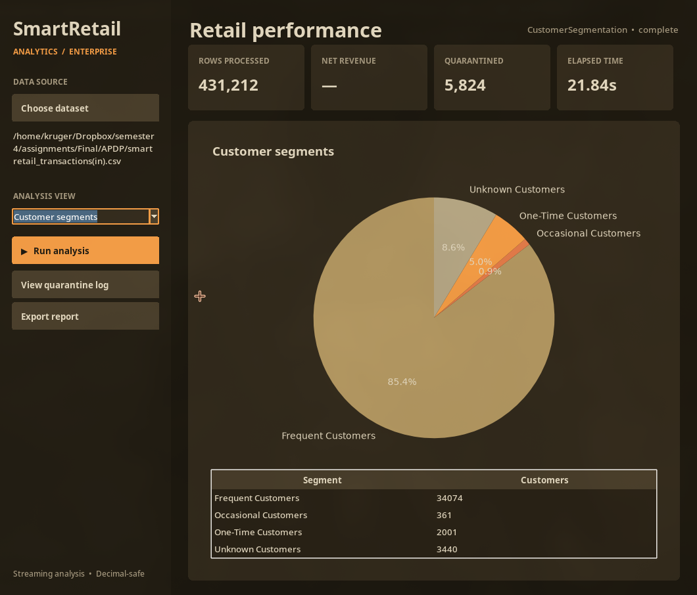

# SmartRetail Analytics

<p align="center">
  
</p>

A Python desktop application for retail transaction ingestion, validation, deduplication, segmentation analytics, and export-ready reporting.

## Highlights

- Chunked CSV ingestion for large retail datasets
- Validation and deduplication for clean transaction data
- Customer segmentation analysis with KPI summaries
- Export to PDF, CSV, and HTML reports
- Lightweight Python-only implementation with a desktop UI

## Demo

<p align="center">
  <video src="demo.mp4" controls width="1000" poster="showcase.png"></video>
</p>

## Run

```bash
python -m pip install -r requirements.txt
python3 main.py
```

## Testing

```bash
python -m pytest -v
```

The analytics engine is built using Python's standard library and is designed for quick retail insight generation from CSV transaction data.

